# MrT Frontend Build Specification

> **Visual product and engineering plan for rebuilding the MrT SPA.**
> Greenfield: the previous frontend was removed in `14e972d`. This document defines
> what to build, how it should look, and the gaps to close before code starts.

| | |
|---|---|
| **Product** | MrT — a daily intelligence workspace for tasks, focus, and career growth |
| **Visual source** | [`asset/DESIGN.md`](asset/DESIGN.md) — “Nordic Monolith” |
| **Composition reference** | [`asset/screen.png`](asset/screen.png) — “MrT // Daily Intelligence” |
| **Product contract** | [`backend/docs/PURPOSE.md`](backend/docs/PURPOSE.md) — priority loop, propose-don’t-decide |
| **API contract** | [`backend/README.md`](backend/README.md) + current route files |
| **Status** | Greenfield — no SPA, no design tokens in code, no API client |
| **Date** | 21 October 2026 |

---

## 0. The short version

`asset/screen.png` is a **poster of one dashboard state**, not a product. It gives
us the visual language — warm limestone, ink monoliths, crimson accents, editorial
typography, hard 90° corners — and one excellent composition. It does **not** give
us navigation, onboarding, task management, trash, settings, auth, mobile, or any
non-happy-path state.

What is still needed:

- **16 product surfaces** and one app shell (Section 4)
- **6 cross-cutting layers**: tokens, primitives, typed API client, auth, server
  state, and observability (Sections 7–10)
- **A real agentic interface** — not a chatbot: proposals with confidence,
  provenance, explicit accept/edit/dismiss, and a degraded mode (Section 6)
- **Trash as a first-class ledger** with restore, purge, and undo (Section 5.7)
- **A complete button and form system**, including destructive confirmation and
  loading/disabled states (Section 7.4)
- **Empty, loading, error, offline, rate-limited, and AI-unavailable states for
  every screen** (Section 5.17)
- **Backend contract fixes before the UI can be honest** — capture currently
  auto-saves, calendar planning queries a retired priority value, and plan
  suggestions cannot store a time (Section 11.2)

### What is already strong

- A distinctive visual system with a clear editorial voice.
- A backend that already models the loop: capture → classify → plan → do → review.
- A product rule worth protecting: **MrT proposes; the human decides.**
- A dashboard reference that reads like a daily newspaper, not generic SaaS.

---

## 1. Reading the reference

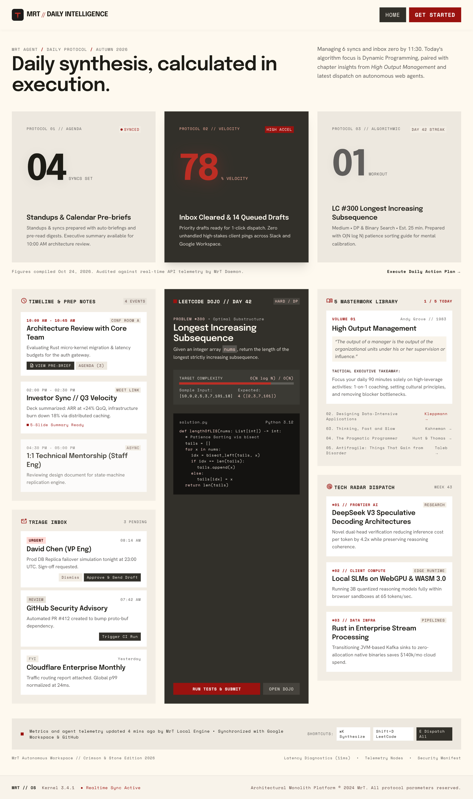

### 1.1 What the screenshot establishes

| Zone | What it proves | What to carry forward |
|---|---|---|
| Top bar | Logo square, `MRT // DAILY INTELLIGENCE`, two actions | Wordmark lockup, ink/crimson contrast, utility actions |
| Hero | Huge Epilogue headline, small grounded subcopy | Editorial hierarchy; the brief headline owns the page |
| Metric row | Three modules, middle one inverted ink | 3-up rhythm; one dark focal module per view |
| Timeline | Time, title, metadata, inline action | Dense calendar agenda with real gaps |
| Dojo | Dark code module, problem metadata, primary action | LeetCode drill as the page’s technical centerpiece |
| Library | Book volume, quote, takeaway, index | Principles as citations, not motivational sludge |
| Tech radar | Numbered feed, category, reading time | daily.dev watchlist with editorial verdicts |
| Triage inbox | Category pips, subject, summary, decisions | Inbox as decisions, not a mail client |
| Footer | Shortcuts, sync state, legal | Persistent system status and keyboard hints |

### 1.2 What the screenshot does not solve

- It is **desktop-only** and ~1200px wide; no tablet or mobile behavior.
- It has **no navigation** to Tasks, Prep, Inbox, Review, Settings, or Trash.
- It shows **only populated data** — no empty, loading, error, or disconnected states.
- Its “78% velocity” and “04 syncs” are **not backed by an API**; we must either
  define the formulas or remove the numbers.
- It is a **public-looking page** (`HOME`, `GET STARTED`) mixed with **private
  intelligence** (inbox, calendar, brief). The build must split public landing
  from authenticated workspace.
- It shows **no proposal review state**, which is the core of the agentic UI.

### 1.3 Design conflicts to resolve

`DESIGN.md` contains three near-neutrals and two crimson values. They are close
but not identical. Lock them before implementation:

| Role | Proposed token | Value | Source |
|---|---|---|---|
| App canvas | `--canvas` | `#F2EDE4` | Screenshot + `surface-container` |
| Paper / elevated | `--paper` | `#FEF9EF` | `surface` |
| Recessed / quiet | `--recessed` | `#EAE5DC` | Brand prose |
| Module fill | `--module` | `#DFD9CE` | Brand prose |
| Module border | `--module-border` | `#D0C8BB` | Brand prose |
| Ink | `--ink` | `#181716` | Brand prose |
| Accent | `--crimson` | `#BD2E24` | Brand prose |
| Accent deep | `--crimson-deep` | `#9A120F` | Frontmatter `primary` |
| Terracotta | `--terracotta` | `#D88B77` | Brand prose |
| Muted text | `--muted` | `#5F5A53` | Darkened for AA |
| Hairline | `--hairline` | `rgba(24,23,22,.15)` | Brand prose |

**Decision:** use `#F2EDE4` as the working canvas because it matches the
screenshot; keep `#FEF9EF` for paper surfaces and `#EAE5DC` for recessed zones.
Record the choice in code and add a visual-regression fixture so the palette does
not drift.

---

## 2. Product model

The Eisenhower Matrix is retired. There is one priority axis and one loop.

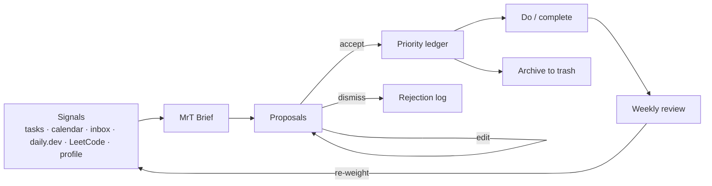

**Priority classes**

| Class | UI label | Meaning | Default behaviour |
|---|---|---|---|
| `now` | **NOW** | Time-critical and matters today | Top of brief; protected |
| `schedule` | **SCHEDULE** | Long-term value: deep work, study, prep | Gets calendar blocks |
| `delegate` | **DELEGATE** | Time-critical, low impact | Triage; not personal work |
| `drop` | **DROP** | Recognisable noise | Visible, not scheduled |

**Non-negotiable product rules**

1. MrT never writes to the task pool or calendar without an explicit human action.
2. Every AI output carries a source, a confidence, and a reason.
3. No open-ended chat. The agent runs bounded jobs with typed outputs.
4. Every screen has a degraded mode when the LLM, database, or integration is down.

---

## 3. Information architecture

### 3.1 Sitemap

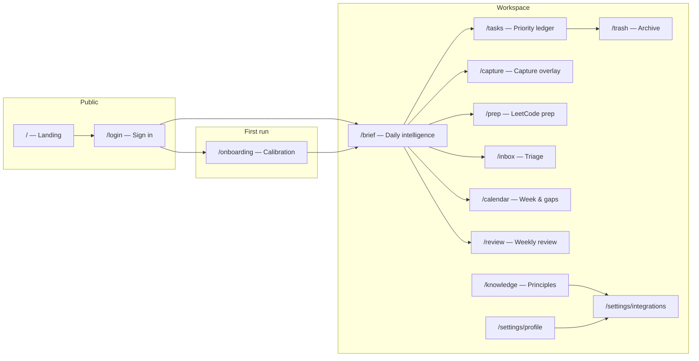

### 3.2 Routes and priority

| Route | Surface | Auth | Primary data | Build priority |
|---|---|---|---|---|
| `/` | Public landing | No | Static | P2 |
| `/login` | Sign in | No | Firebase Auth | P0 |
| `/onboarding` | Calibration | Yes | `GET /api/onboarding`, `GET/PUT /api/profile` | P0 |
| `/brief` | Daily intelligence (default) | Yes | `GET /api/briefing` | P0 |
| `/tasks` | Priority ledger | Yes | `GET /api/tasks` | P0 |
| `/tasks/:id` | Task drawer deep link | Yes | `GET /api/tasks` | P1 |
| `/capture` | Capture full screen / overlay | Yes | `POST /api/capture` | P0 |
| `/trash` | Archived tasks | Yes | `GET /api/tasks?status=archived` | P0 |
| `/prep` | LeetCode prep | Yes | `/api/leetcode/*` | P1 |
| `/inbox` | Email triage | Yes | `/api/email/triage` | P1 |
| `/calendar` | Week, gaps, plan | Yes | `/api/calendar/*` | P1 |
| `/review` | Weekly review | Yes | `/api/review/weekly` | P1 |
| `/knowledge` | Principles corpus | Yes | `/api/knowledge/*` | P2 |
| `/settings/profile` | Profile | Yes | `/api/profile` | P1 |
| `/settings/integrations` | Connections | Yes | `/api/integrations` | P1 |
| `*` | Not found | — | — | P0 |

### 3.3 Navigation model

- **Desktop:** 72px ink rail, icon + label on hover/focus, crimson active marker.
- **Top bar:** page title, live date, `⌘K Capture`, sync state, avatar.
- **Mobile:** 64px bottom bar — Brief, Tasks, **Capture**, Prep, More.
- **More sheet:** Inbox, Calendar, Review, Principles, Trash, Settings.
- **Rail order:** Brief · Tasks · Prep · Inbox · Calendar · Review · More.

The screenshot’s top navigation is a marketing pattern. The app needs persistent
navigation; the reference becomes the shell’s typographic and tonal language.

---

## 4. Core user journeys

### 4.1 First run

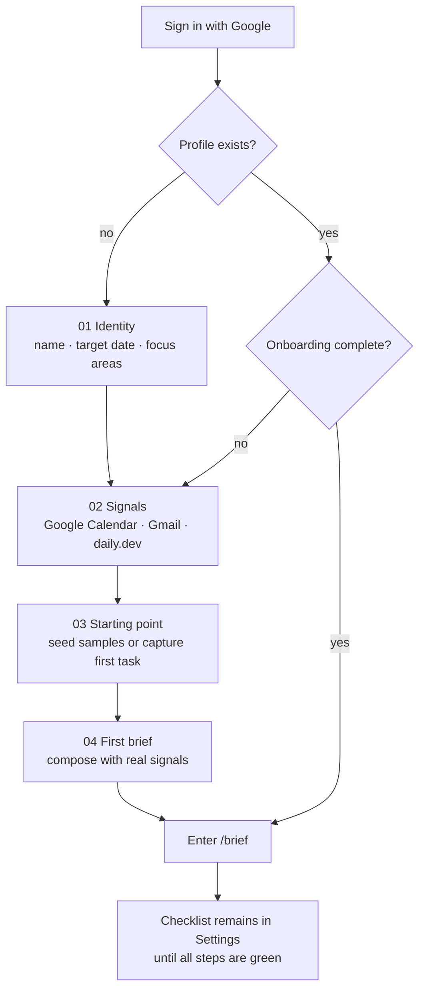

**Rules**

- Every step is skippable; the workspace stays usable.
- Profile saves on continue (`PUT /api/profile`), not only at the end.
- `GET /api/onboarding` drives the checklist: `seeded_tasks`,
  `daily_dev_connected`, `google_connected`, `knowledge_ingested`, `llm_ready`.
- If `llm_ready` is false, show **“MrT is running in manual mode”** and continue
  without brief/capture; never block the whole product.
- Seeding is idempotent and refuses a non-empty ledger; present it as a choice,
  not a default.

### 4.2 Session and authentication

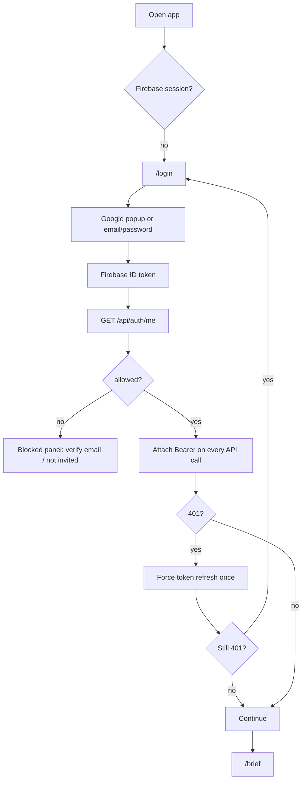

- Google popup is the primary path; email/password is the fallback.
- Accounts are invite-only. `/api/auth/me` decides between the workspace and a
  blocked panel that explains an unverified email or missing invite.
- Handle popup blocked, cancelled, network failure, disabled account, and expired
  session with specific copy — not a generic “Something went wrong”.
- Never store tokens in `localStorage`; use the Firebase SDK’s token lifecycle.
- Non-admin API calls are budgeted per user (60/min plus 10 LLM actions/hour);
  show the server’s `Retry-After` when a `429` arrives.

### 4.3 The daily loop

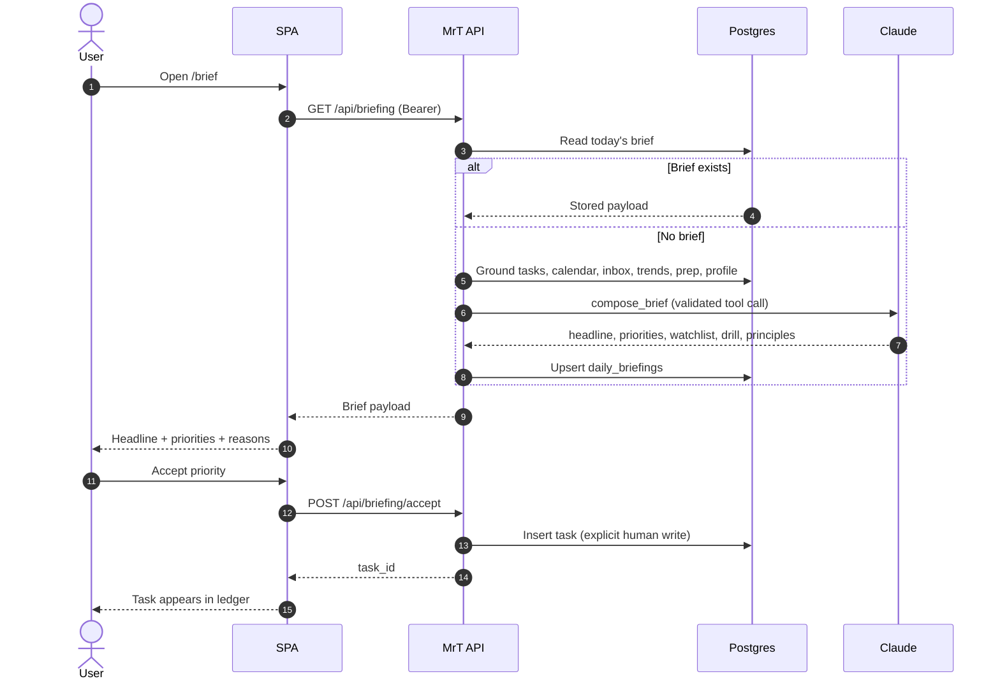

### 4.4 Capture and proposal review

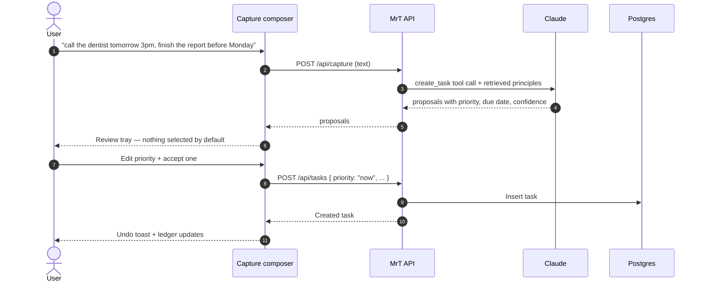

> **Contract blocker:** today `/api/capture` also persists proposals automatically
> when a database is configured. That breaks this flow and the product’s
> “propose, don’t decide” rule. See Section 11.2, blocker **B1**.

### 4.5 Proposal lifecycle

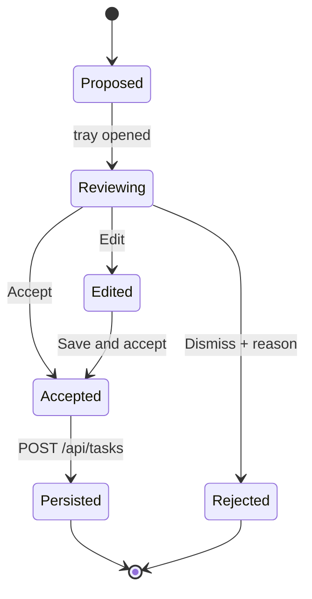

**Rules**

- Nothing is selected by default.
- “Accept selected” is explicit; no one-click “accept all” in v1.
- Dismissal captures a reason (`not_now`, `wrong_priority`, `duplicate`,
  `not_mine`) so the backend can learn from corrections.
- The same accept/dismiss discipline applies to email triage, brief priorities,
  and calendar suggestions. Triage uses its category (`reply`, `fyi`, `task`,
  `ignore`) in place of a confidence value.

### 4.6 Task lifecycle

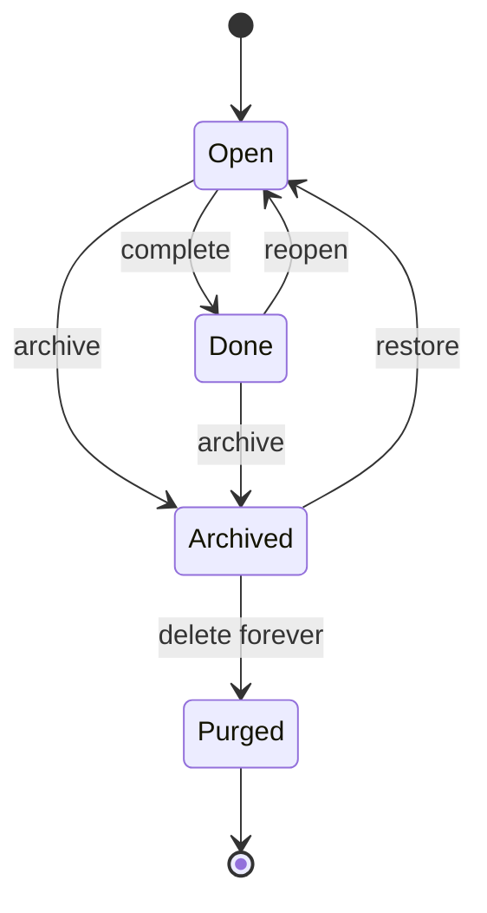

- Archiving is the Trash. Restoring uses `PATCH /api/tasks/:id` with
  `{ "status": "open" }`.
- Purge is permanent: `DELETE /api/tasks/:id?purge=true`, behind a typed
  confirmation.
- Undo is offered for archive and completion. Purge has no undo and must say so.

---

## 5. Screen specifications

### 5.1 App shell

```
┌──────┬──────────────────────────────────────────────────────────────────────────────┐
│  T   │  MRT // DAILY INTELLIGENCE           WED 21 OCT        ⌘K CAPTURE   [AV]     │
│      ├──────────────────────────────────────────────────────────────────────────────┤
│  ◉   │                                                                              │
│  ▤   │                              page content                                    │
│  ◫   │                                                                              │
│  ◈   │                                                                              │
│  ✉   │                                                                              │
│  ◷   │                                                                              │
│  ▥   │                                                                              │
│      │                                                                              │
│  ?   │                                                                              │
├──────┴──────────────────────────────────────────────────────────────────────────────┤
│ ● SYNC 07:04   API OK   ⌘K capture   G+B brief   ? shortcuts                        │
└─────────────────────────────────────────────────────────────────────────────────────┘
```

**Anatomy**

- **Rail:** ink, 72px, logo, six destinations, help, avatar at bottom.
- **Top bar:** 64px, canvas, 1px hairline bottom; title, date, capture, sync, avatar.
- **Content:** max 1440px, 12-column grid, 32px margins, 24px gutters.
- **Status bar:** 32px, Space Mono, system health from `/healthz`, last sync, keys.
- **Overlays:** command palette, capture, task drawer, dialogs, toasts.

**Behaviour**

- `⌘K` opens the command layer from anywhere.
- Rail items show focus rings; active item has a 2px crimson left bar.
- Sync state is honest: `SYNCED 07:04`, `STALE 3H`, `OFFLINE`, `NOT CONNECTED`.
- The status bar is not decorative; it is the first place a failure is explained.

### 5.2 Dashboard — `/brief`

The dashboard is the brief. It is a daily broadsheet, not a widget farm.

```
┌────────────────────────────────────────────────────────────────────────────────────┐
│  Daily synthesis, calculated in execution.                          [REFRESH]      │
│  Composed 07:00 · 4 signals · 3 priorities · 2 watched                             │
│                                                                                    │
│  ┌ 03 PRIORITIES ─────┐  ┌ 78% THIS WEEK ─────┐  ┌ 01 DRILL DUE ─────┐            │
│  │ 2 due today        │  │ completion · +6 pts │  │ DP · Medium       │            │
│  │ [OPEN LEDGER →]    │  │ [VIEW REVIEW →]    │  │ [START DRILL →]   │            │
│  └────────────────────┘  └────────────────────┘  └───────────────────┘            │
│                                                                                    │
│  ┌ TIMELINE — 5 ────────────────┐ ┌ DOJO — 4 ───────────┐ ┌ LIBRARY — 3 ────────┐ │
│  │ 09:00 standup                │ │ #300 LIS            │ │ High Output         │ │
│  │ 11:00 architecture review    │ │ DP · 25 min         │ │ Management          │ │
│  │ 14:00 2h gap                 │ │ [LOG ATTEMPT]       │ │ “the output…”       │ │
│  └──────────────────────────────┘ └─────────────────────┘ └─────────────────────┘ │
│                                                                                    │
│  ┌ TECH RADAR — 7 ─────────────────────────────┐ ┌ INBOX PULSE — 5 ─────────────┐ │
│  │ 01 DeepSeek V3 …                            │ │ 3 replies · 2 FYI · 1 task   │ │
│  │ 02 Local SLMs …                             │ │ [TRIAGE →]                   │ │
│  └─────────────────────────────────────────────┘ └──────────────────────────────┘ │
└────────────────────────────────────────────────────────────────────────────────────┘
```

**Data mapping**

| Module | Source | Empty state |
|---|---|---|
| Headline | `brief.payload.headline` | “No brief yet. Compose the first one.” |
| Priorities | `brief.payload.priorities[]` | “No priorities. Capture work or accept a brief item.” |
| Watchlist | `brief.payload.watchlist[]` | “No reading picks today.” |
| Drill | `brief.payload.leetcode` | “No pattern due. Choose one from Prep.” |
| Daily drill | `brief.payload.leetcode.challenge` | Saved offline drill when AI generation is unavailable |
| Principles | `brief.payload.principles_used[]` | “No principle cited today.” |
| Timeline | `GET /api/calendar/events?days=7` | “Connect Google Calendar to see the week.” |
| Tech radar | `GET /api/integrations/dailydev/feeds` | “No cached feeds. Refresh daily.dev.” |
| Inbox pulse | `GET /api/email/triage?state=open` | “Connect Gmail to triage.” |
| Week completion | `GET /api/review/weekly` aggregates | “First review lands Saturday.” |

**Metric rules**

- **Priorities:** `priorities.length`, plus count due today from the ledger.
- **Week completion:** `completed / max(created, 1)` from weekly analytics; label
  the formula in a tooltip. Do not ship “velocity” without a definition.
- **Drill due:** count of patterns with `next_review <= today`.
- **Daily drill:** start the countdown, reveal hints progressively, and show the
  reference answer automatically at 00:00. The AI-composed drill wins; a saved
  offline drill keeps the surface usable when generation is unavailable.

**Interactions**

- Refresh is optimistic only after the server confirms; show a staged progress
  label (`Reading signals → Composing → Validating`) with a 30s timeout.
- Priority rows open the task drawer; accept buttons live in the Brief detail list,
  not on the headline card.
- Any module can be reordered in a future release; v1 is fixed.

### 5.3 Brief proposal rows

```
┌ 01 ─────────────────────────────────────────────────────────────── HIGH ─┐
│ Finish the metrics report draft                                           │
│ NOW · due Fri 24 Oct · #work #writing                                     │
│ WHY  Overdue risk; 2h gap at 14:00 and no meeting conflict.               │
│ [ACCEPT]  [EDIT]  [DISMISS ▾]                                             │
└───────────────────────────────────────────────────────────────────────────┘
```

- Confidence is `high`, `medium`, `low`; low confidence requires an edit before
  accept (disabled accept with helper text).
- The `WHY` line is mandatory and comes from the brief payload.
- Dismiss opens a small reason menu, not a modal.
- No hidden auto-focus on Accept; keyboard focus starts on the row.

### 5.4 Capture — `/capture` and `⌘K`

```
┌──────────────────────────────────────────────────────────────────────────────┐
│  MRT // CAPTURE                                                         ESC  │
│  ──────────────────────────────────────────────────────────────────────────  │
│  › call the dentist tomorrow 3pm, finish the metrics report before Monday    │
│                                                                              │
│  [CLASSIFY]                                                    0 / 500       │
│  ──────────────────────────────────────────────────────────────────────────  │
│  PROPOSALS 02                                                                │
│  ┌ [ ] 01 ─────────────────────────────────────────────── HIGH ─┐            │
│  │ Call the dentist                                  NOW · 22 Oct │            │
│  │ [EDIT] [DISMISS]                                             │            │
│  └──────────────────────────────────────────────────────────────┘            │
│  ┌ [ ] 02 ────────────────────────────────────────────── MEDIUM ─┐            │
│  │ Finish metrics report draft                       NOW · 26 Oct │            │
│  │ [EDIT] [DISMISS]                                             │            │
│  └──────────────────────────────────────────────────────────────┘            │
│  [ACCEPT SELECTED]   [CAPTURE MORE]                                          │
└──────────────────────────────────────────────────────────────────────────────┘
```

**Anatomy and rules**

- One large input, bottom border only; `Enter` submits, `Shift+Enter` newlines.
- Example prompts rotate only on empty focus, never over typed text.
- Proposals are checkboxes, none selected by default.
- Edit opens inline fields for title, priority, due date, tags.
- Accept calls `POST /api/tasks`; the backend is the source of truth.
- Dismiss calls no endpoint in v1; store locally and log to analytics.
- If capture fails, keep the text and offer retry; never clear the composer.
- If the LLM is unavailable, show **“Classification is offline. Create a task
  manually.”** with the manual form prefilled from the text.
- Mobile: full-screen route, sticky bottom action bar, keyboard-safe layout.

### 5.5 Tasks — `/tasks` (Priority ledger)

Four lanes on desktop, one accordion on mobile.

```
┌ NOW 03 ──────────────┐ ┌ SCHEDULE 05 ─────────┐ ┌ DELEGATE 02 ─────────┐ ┌ DROP 01 ────────────┐
│ [ ] Ship incident    │ │ [ ] Rust ownership   │ │ [ ] Reschedule 1:1   │ │ [ ] Old newsletter  │
│     due today · #eng │ │     due Fri · #study │ │     due today        │ │                     │
│ [ ] Metrics draft    │ │ [ ] DP drill         │ │                      │ │                     │
│     due Fri · #work  │ │     from prep        │ │                      │ │                     │
└──────────────────────┘ └──────────────────────┘ └──────────────────────┘ └─────────────────────┘
```

**Header:** title, count, view toggle (board/list), search, filter by source/tag,
sort by due/created, `NEW TASK`, `CAPTURE`.

**Task card**

- Checkbox (44px touch target), title, due date, source pip, confidence for AI
  tasks, tags, overflow menu.
- Hover reveals quick actions: complete, move, archive.
- Drag between lanes is supported with `dnd-kit`; keyboard alternative is
  `Move to…` in the overflow menu.
- Optimistic update on complete; rollback on error with a specific toast.

**Task drawer**

- 480px right drawer, full-screen on mobile.
- Editable title, description, priority segmented control, due date, tags.
- Read-only provenance: source, confidence, created, completed.
- Actions: `MARK DONE`, `ARCHIVE`, `RESTORE` (if archived), `DELETE FOREVER`
  (only in Trash).
- Unsaved-changes guard on close.
- **API limitation:** `PATCH` cannot clear a due date or description. Until the
  backend supports nulls, the UI must not offer “Clear date” (see B4).

**Filters**

- URL state: `?priority=now&status=open&source=gmail&tag=work`.
- Client-side filtering is acceptable for v1; the API only filters by `status`.
- Empty lane copy is specific: “Nothing in NOW. Protect that.”

### 5.6 Completed tasks

- Same ledger with `status=done`; grouped by completion date.
- Completion timestamp comes from `completed_at`.
- Reopen uses `PATCH { status: "open" }`.
- No separate route in v1; toggle inside `/tasks`.

### 5.7 Trash — `/trash`

```
┌──────────────────────────────────────────────────────────────────────────────┐
│  TRASH                                                     16 ARCHIVED       │
│  Archived tasks stay here until you purge them.                              │
│  ──────────────────────────────────────────────────────────────────────────  │
│  Reschedule 1:1          DELEGATE   created 18 Oct   [RESTORE] [PURGE]       │
│  Old newsletter          DROP       created 12 Oct   [RESTORE] [PURGE]       │
└──────────────────────────────────────────────────────────────────────────────┘
```

**Rules**

- Source: `GET /api/tasks?status=archived`.
- Restore: `PATCH /api/tasks/:id { status: "open" }`.
- Purge: `DELETE /api/tasks/:id?purge=true` with a confirmation dialog that names
  the task and states that it cannot be undone.
- **No bulk actions in v1.** The API has no batch restore/purge; do not show
  selection checkboxes that imply otherwise. Add them only when the backend does.
- **API gap:** `archived_at` is not returned, so show the created date and label
  it accurately. Do not invent an archive date.
- Empty state: “Trash is clear. Archived tasks rest here until you purge them.”
- No “empty trash” until a bulk purge endpoint exists.

### 5.8 Onboarding — `/onboarding`

```
┌──────────────────────────────────────────────────────────────────────────────┐
│  MRT // CALIBRATION                                              01 / 04     │
│  ──────────────────────────────────────────────────────────────────────────  │
│  Who is MrT planning for?                                                    │
│                                                                              │
│  NAME           [ Christian Tazma                                        ]   │
│  TARGET DATE    [ 2026-12-01 ]   optional                                    │
│  FOCUS          [ rust ] [ system design ] [ + add ]                         │
│                                                                              │
│  MrT uses this to ground priorities and drills.                              │
│                                                                              │
│  [BACK]                                                     [CONTINUE →]      │
└──────────────────────────────────────────────────────────────────────────────┘
```

**Steps**

| Step | Screen | API | Skip |
|---|---|---|---|
| 01 | Identity: name, target interview date, up to 8 focus areas | `PUT /api/profile` | Yes |
| 02 | Signals: Google Calendar, Gmail, daily.dev | `/api/integrations/*` | Yes |
| 03 | Starting point: seed four samples or capture first task | `POST /api/onboarding/seed`, `POST /api/capture` | Yes |
| 04 | First brief: compose and reveal | `POST /api/briefing/refresh` | Yes |

- Progress is a four-block indicator, not a rounded stepper.
- Resume from `GET /api/onboarding`; never ask for the same thing twice.
- The final screen shows what MrT will do next, then lands on `/brief`.
- If step 04 fails, land on `/brief` with the error and a retry; do not trap the
  user in onboarding.
- **daily.dev is not a user OAuth flow.** The token lives on the server. The UI
  can warm or refresh the cache (`POST /api/integrations/dailydev/feeds`); if the
  deployment has no token, show “Not configured” and skip the step.

### 5.9 Prep — `/prep`

```
┌──────────────────────────────────────────────────────────────────────────────┐
│  PREP // PATTERNS, NOT PROBLEMS                        12 DUE · 6-DAY STREAK  │
│  ──────────────────────────────────────────────────────────────────────────  │
│  ┌ TODAY'S DRILL ────────────────────────┐ ┌ PATTERN LIBRARY ──────────────┐ │
│  │ Dynamic Programming        MEDIUM     │ │ Two Pointers      4/5  due 22 │ │
│  │ Confidence 3/5 · next review today    │ │ Sliding Window    3/5  due 24 │ │
│  │ “Track the state you reuse.”          │ │ Binary Search     5/5  due 28 │ │
│  │ [LOG ATTEMPT]                         │ │ [+ NEW PATTERN]               │ │
│  └───────────────────────────────────────┘ └───────────────────────────────┘ │
│                                                                              │
│  ATTEMPTS / PATTERN     NO-HELP RATE     AVG TIME                            │
│  ██████  DP 12           ██████ 71%       ██████ 24m                          │
└──────────────────────────────────────────────────────────────────────────────┘
```

- Pattern library: name, confidence 1–5, next review, ease, notes.
- Add/edit pattern drawer: `POST /api/leetcode/patterns`.
- Delete pattern: `POST /api/leetcode/patterns/:id/delete` with confirmation.
- Log attempt: URL (required), title, difficulty, pattern, time, needed help, notes.
  Response shows reschedule (`next_review`, `interval_days`, `ease`) and the
  created review task.
- Stats: `GET /api/leetcode/stats` — attempts, no-help rate, average time.
- Attempt history: `GET /api/leetcode/attempts?limit=30`.
- **API drift:** the README advertises `PATCH /api/leetcode/attempt/{id}`; the
  current router does not implement it. Do not show “Edit attempt” until it does.
- Empty state: “No patterns yet. Add the first one and MrT will schedule reviews.”

### 5.10 Inbox — `/inbox`

```
┌──────────────────────────────────────────────────────────────────────────────┐
│  INBOX // DECISIONS, NOT NOISE          METADATA ONLY · 15 PER RUN           │
│  [RUN TRIAGE]                                               Last run 07:02  │
│  ──────────────────────────────────────────────────────────────────────────  │
│  ALL 12   REPLY 3   FYI 5   TASK 2   IGNORE 2                                │
│  ──────────────────────────────────────────────────────────────────────────  │
│  ● REPLY   David Chen · Prod DB replica failover         08:14               │
│            “Sign-off requested for tonight’s 23:00 run.”                     │
│            [DONE] [CREATE TASK] [OPEN IN GMAIL ↗]                            │
│  ● FYI     Cloudflare monthly                            07:42               │
│            “Routing report attached. Global p99 normalized at 24ms.”         │
└──────────────────────────────────────────────────────────────────────────────┘
```

**Rules**

- `POST /api/integrations/gmail/triage` runs triage (≤15 unseen threads).
- `GET /api/email/triage?state=open|done|task_created|all`.
- Act: `POST /api/email/triage/{gmail_msg_id}/act` with
  `{ action: "done" }` or `{ action: "task", task_title }`.
- Category pips: reply = crimson, fyi = muted, task = ink, ignore = hairline.
- “Open in Gmail” uses `https://mail.google.com/mail/u/0/#all/{msg_id}`; the
  backend never fetches the body.
- Triage run shows a staged status and a timeout; on 503, show the connect CTA.
- No undo after acting in v1, because the API has no un-act endpoint. Say so in a
  confirmation tooltip, or make Done instant and move on.

### 5.11 Calendar — `/calendar`

```
┌──────────────────────────────────────────────────────────────────────────────┐
│  WEEK OF 20 OCT                                        [SYNC NOW]  7 EVENTS   │
│  MON 20      TUE 21       WED 22       THU 23       FRI 24                   │
│  ──────────────────────────────────────────────────────────────────────────  │
│  09:00 ██   09:00 ██     09:00 ██     09:00 ██     09:00 ██                 │
│  11:00 ██   11:00 ██     ░░ gap 2h ░░ 11:00 ██     ░░ gap 3h ░░             │
│  14:00 ██   14:00 ░░     14:00 ██     14:00 ██     14:00 ██                 │
│  ──────────────────────────────────────────────────────────────────────────  │
│  PLAN PROPOSALS                                                              │
│  ┌ Schedule “Rust ownership notes” · Tue 14:00 · 120 min ─────────────────┐  │
│  │ Why: first 2h gap with no meeting conflict.          [ACCEPT] [DISMISS] │  │
│  └────────────────────────────────────────────────────────────────────────┘  │
└──────────────────────────────────────────────────────────────────────────────┘
```

- Data: `GET /api/calendar/events?days=7`; sync `POST /api/calendar/sync`.
- Plan: `GET /api/calendar/plan` — window, meeting minutes, gaps, suggestions.
- Event fields: `event_id`, `title`, `start_at`, `end_at`, `busy` (UTC ISO).
- Render in the user’s local timezone; show the timezone label.
- Mirrors are read-only; no editing calendar events.
- **API blocker:** suggestions carry `suggested_start`, but tasks only have a
  `due_date` (date, no time), so accepting cannot store the proposed time. Until
  the backend adds `scheduled_start`/`scheduled_end`, present suggestions as
  “add to task as due date” and label the limitation (see B3).
- **API bug:** the planner queries `priority = 'not_urgent_important'`, a retired
  quadrant value. It will always return zero suggestions. Fix before this screen
  ships (see B2).

### 5.12 Review — `/review`

```
┌──────────────────────────────────────────────────────────────────────────────┐
│  WEEKLY REVIEW // 13–19 OCT                          [RUN REVIEW]  [‹] [›]   │
│  ──────────────────────────────────────────────────────────────────────────  │
│  COMPLETED 14   CREATED 18   CARRIED 4   OVERDUE 2                           │
│  ┌ PRIORITY BREAKDOWN ──────────────┐ ┌ LEETCODE ─────────────────────────┐ │
│  │ NOW ███████ 8                    │ │ 7 attempts · 71% no-help          │ │
│  │ SCHEDULE ████ 4                  │ │ 3 patterns due                    │ │
│  │ DELEGATE ██ 2                    │ └───────────────────────────────────┘ │
│  └──────────────────────────────────┘                                        │
│  ┌ INBOX ───────────┐ ┌ PRINCIPLES ───────────────────────────────────────┐  │
│  │ 3 replies open   │ │ High Output Management · 5 accepted · 12 surfaced  │  │
│  └──────────────────┘ └───────────────────────────────────────────────────┘  │
│  VERDICT                                                                     │
│  “This week moved the needle on prep, not on delivery.”                      │
└──────────────────────────────────────────────────────────────────────────────┘
```

- `GET /api/review/weekly?week=YYYY-MM-DD` returns `{ analytics, stored }`.
- `POST /api/review/weekly/run` computes and upserts the week.
- Render `stored.payload` defensively: the narrative shape may vary; fall back to
  analytics-only if the verdict is absent.
- Charts: square bars, 1px grid, ink/crimson/terracotta, no gradients.
- Week navigation is client-side; each week is a separate query.
- Trend charts require multiple weeks. Fetch lazily and cache; if this becomes
  slow, add a range endpoint (B6).
- Empty state: “No review yet. Run the first one.”

### 5.13 Knowledge — `/knowledge`

```
┌──────────────────────────────────────────────────────────────────────────────┐
│  PRINCIPLES // THE EDITORIAL VOICE                    [SEARCH PRINCIPLES]    │
│  ──────────────────────────────────────────────────────────────────────────  │
│  HIGH OUTPUT MANAGEMENT                                   5 ITEMS · 2 ACTIVE │
│  “The output of a manager is the output of the organisation…”                │
│  weight 1.00 → 1.42   accepted 5   conflicts 1   surfaced 12   [WORTH KEEPING]│
│  ──────────────────────────────────────────────────────────────────────────  │
│  THE PRAGMATIC PROGRAMMER                                 8 ITEMS · 1 Q’D   │
│  “Your knowledge portfolio is a set of investments…”                         │
│  weight 1.00 → 0.10   QUARANTINED · 0 accepts / 11 surfaces                  │
└──────────────────────────────────────────────────────────────────────────────┘
```

- `GET /api/knowledge/items`, `GET /api/knowledge/weights`.
- Search: `POST /api/knowledge/search` with hybrid retrieval; show score and source.
- Feedback: `POST /api/knowledge/feedback` — “worth keeping”.
- Quarantine is explained inline: deprioritised, never deleted.
- Ingest is a developer action; keep it in Settings → Corpus, not primary nav.
- Empty state: “The corpus is empty. Ingest the books to give MrT its voice.”

### 5.14 Integrations — `/settings/integrations`

- Cards: Google Calendar, Gmail, daily.dev, Knowledge corpus, Anthropic status.
- `GET /api/integrations` returns `providers`, `calendar_events_cached`,
  `clients_configured`.
- Connect Google: `GET /api/integrations/google/url` → redirect.
- Connect Gmail: `GET /api/integrations/gmail/url` → redirect.
- Disconnect: `DELETE /api/integrations/google` or `/api/integrations/gmail`.
  Confirm first; state that mirrored data and tokens are revoked, triage rows are
  kept.
- daily.dev: `GET` cached feeds, `POST` refresh; token stays server-side.
- Show scopes in plain language, not OAuth strings.
- Degraded state: if a client is not configured, show “Not configured on this
  deployment” instead of a broken Connect button.

### 5.15 Profile — `/settings/profile`

- Name, target interview date, focus areas (max 8), save.
- Account email and sign-out from Firebase.
- Keyboard shortcuts sheet and build/version from `/healthz`.
- No avatar upload in v1; no theme toggle until dark mode is designed.
- Destructive account deletion is not offered because the backend has no endpoint.

### 5.16 Public landing — `/`

- Reuse the screenshot’s hero and three-module composition.
- Header: wordmark, `SIGN IN`, `GET STARTED` (crimson).
- Hero: headline, grounded subcopy, one CTA.
- Proof: three real capability modules — Propose, Plan, Review — not fake metrics.
- Footer: privacy note, status, author.
- Authenticated users redirect to `/brief`.

### 5.17 System states

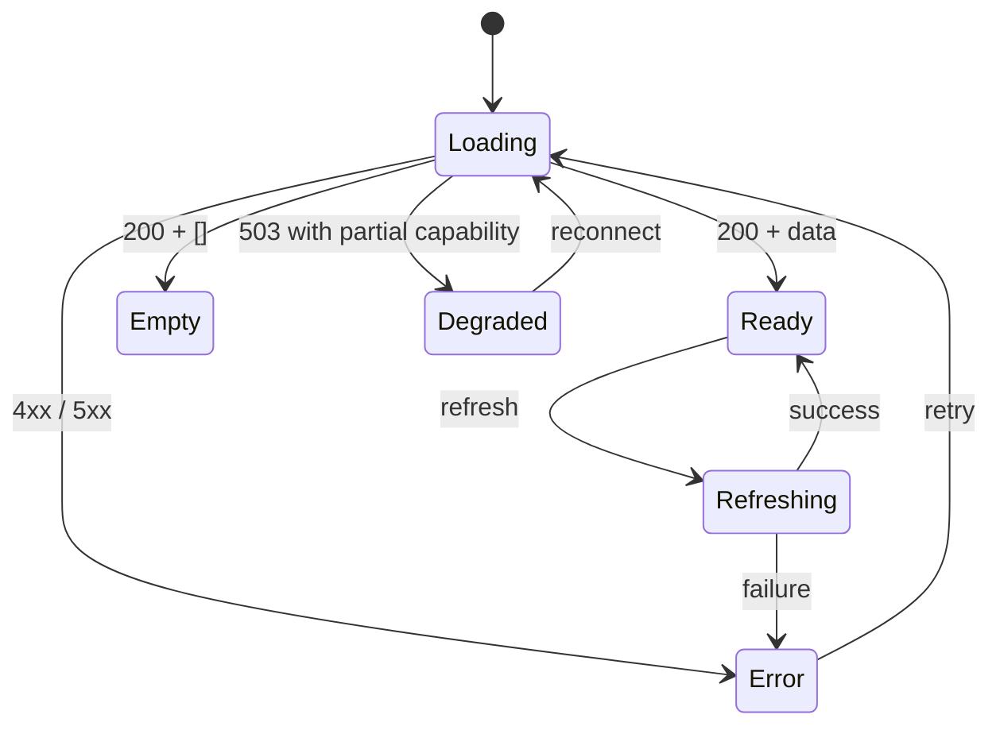

Every screen must implement:

| State | Pattern |
|---|---|
| Loading | Module-shaped skeletons; no generic spinner except agent jobs |
| Empty | One sentence of product voice + one action |
| Error | What failed, whether data is stale, retry |
| Degraded | What still works; disable only the affected actions |
| Offline | Persistent status bar; cached data marked “stale” |
| 401 | One token refresh, then sign-in |
| 429 | Countdown from `Retry-After`; disable agent actions |
| 503 | Explain missing configuration in user terms |
| Partial | Render available modules; do not blank the page |

Global overlays:

- **Command palette:** `Capture`, `Go to…`, `New task`, `Refresh brief`,
  `Sync calendar`, `Run triage`, `Keyboard shortcuts`.
- **Toast:** square, ink or paper, 4s; destructive actions get 8s with Undo.
- **Shortcut sheet:** `?`.
- **Error boundary:** per route, with a copyable trace ID.

---

## 6. The agentic interface

### 6.1 Principle: a colleague with a desk, not a chat window

MrT is a pipeline, not a conversationalist. The UI should feel like reviewing a
competent colleague’s work: concise artifacts, visible reasoning summaries,
clear provenance, and a decision.

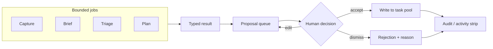

### 6.2 The three agent surfaces

| Surface | Where | Job |
|---|---|---|
| **Capture composer** | `⌘K`, `/capture` | Turn language into reviewed proposals |
| **Proposal tray** | Inline on Brief, Capture, Inbox, Calendar | Accept / edit / dismiss with provenance |
| **Run strip** | Shell status bar + drawer | Show what ran, when, with what result |

### 6.3 Proposal card anatomy

```
┌ 02 ─ PROPOSED BY MRT ─────────────────────────────── MEDIUM ┐
│ Finish the metrics report draft                              │
│ NOW · due Mon 26 Oct · #work #writing                        │
│ WHY  Due before the review; the 14:00 gap is still open.     │
│ SOURCE  capture · confidence 0.72                            │
│ [ACCEPT]  [EDIT]  [DISMISS ▾]                                │
└──────────────────────────────────────────────────────────────┘
```

- **Source** is always visible: `capture`, `brief`, `gmail`, `daily.dev`,
  `leetcode`, `user`.
- **Confidence** is a label plus a value when available. Low confidence disables
  Accept until edited.
- **Why** is a single line, never a paragraph.
- **Dismiss** captures a reason; do not hide it in a menu without a label.

### 6.4 Run strip

```
MRT // LAST RUN 07:00 · 4 signals · 3 proposals · 1 skipped      [VIEW LOG]
```

Drawer content per run:

- Job name (`brief`, `capture`, `triage`, `plan`)
- Started / finished / duration
- Model name and token count when available
- Inputs summarised (`tasks 12 · calendar 7 · inbox 9`)
- Outputs (`3 priorities · 2 watch items`)
- Errors and retry state

There is no server-side activity endpoint yet, so v1 stores the session run log
client-side and reads `/healthz` for capability. Flag this as an API gap; do not
pretend the log is durable.

### 6.5 Agent rules

1. **No open-ended chat.** Every input maps to a bounded endpoint.
2. **No auto-write.** Accept is always explicit.
3. **No fake progress.** Use staged labels only when the server exposes stages;
   otherwise use an indeterminate bar.
4. **No fake certainty.** Confidence is not a percentage of truth; label it.
5. **No silent failure.** A failed job leaves the input intact and explains the
   fallback.
6. **No auto-accept.** No default-selected proposals, no “accept all” in v1.
7. **No orphaned writes.** After accept, the new task must be visible in the
   ledger via cache invalidation, not a page reload.
8. **No invisible LLM.** Surface the model/version only in the run log, not the
   main reading flow.

### 6.6 Degraded agent states

| Condition | UI |
|---|---|
| No Anthropic key | “MrT is in manual mode.” AI buttons disabled with explanation |
| Rate limited | Countdown tied to `Retry-After`; manual capture remains |
| Brief timeout | Keep cached brief, mark stale, offer retry |
| Triage unavailable | Inbox shows connection/config CTA |
| RAG unavailable | Brief still composes without principles; label “no principles cited” |
| Daily.dev unavailable | Watchlist empty state; no error toast storm |

---

## 7. Design system

### 7.1 Foundations

| Token | Value | Use |
|---|---|---|
| `--canvas` | `#F2EDE4` | Page background |
| `--paper` | `#FEF9EF` | Inputs, lifted reading surfaces |
| `--recessed` | `#EAE5DC` | Quiet zones, table hover |
| `--module` | `#DFD9CE` | Cards and modules |
| `--module-border` | `#D0C8BB` | 1px card borders |
| `--ink` | `#181716` | Text, monoliths, primary buttons |
| `--ink-soft` | `#32302A` | Secondary dark surfaces |
| `--cream` | `#F5F0E7` | Text on ink |
| `--muted` | `#5F5A53` | Metadata that must meet AA |
| `--crimson` | `#BD2E24` | Accent, urgent, active |
| `--crimson-deep` | `#9A120F` | Pressed, small text on light |
| `--terracotta` | `#D88B77` | Warm badges, metric fills |
| `--hairline` | `rgba(24,23,22,.15)` | Section rules |
| `--danger` | `#BA1A1A` | Errors |
| `--success` | `#3F6B4F` | Confirmed states, sparingly |

**Non-negotiables**

- Radius: **0** everywhere. No pills, no rounded avatars, no soft cards.
- Shadow: **none**. Depth comes from tonal zones and 1px rules.
- Borders: 1px, never 2px except focus.
- Grid: 8px rhythm; generous negative space above content.
- Gradients: none. Glows: none. Glassmorphism: none.

### 7.2 Typography

| Role | Family | Size / line / tracking |
|---|---|---|
| Display | Epilogue 700 | 56 / 60 / −0.03em |
| Headline LG | Epilogue 600 | 40 / 44 / −0.025em |
| Headline MD | Epilogue 600 | 24 / 28 / −0.015em |
| Headline SM | Epilogue 600 | 18 / 24 / −0.01em |
| Body LG | Hanken Grotesk 400 | 18 / 28 |
| Body MD | Hanken Grotesk 400 | 15 / 24 |
| Body SM | Hanken Grotesk 400 | 13 / 20 |
| Label LG | Space Mono 700 | 13 / 18 / 0.04em |
| Label MD | Space Mono 400 | 11 / 16 / 0.06em |
| Label SM | Space Mono 400 | 10 / 14 / 0.08em |

- Use `clamp()` for display sizes: 56 → 40 → 30 on mobile.
- Tabular numerals for metrics and time.
- Self-host WOFF2; preload Epilogue 700 and Hanken Grotesk 400; `font-display: swap`.
- Uppercase labels are part of the voice, but do not uppercase body copy.
- Never use Space Mono for long paragraphs.

### 7.3 Layout system

| Breakpoint | Columns | Margins | Gutters | Shell |
|---|---|---|---|---|
| ≥1440 | 12 | 32px | 24px | Rail + optional context rail |
| 1280–1439 | 12 | 32px | 24px | Rail |
| 1024–1279 | 12 | 24px | 20px | Rail, condensed |
| 768–1023 | 8 | 24px | 16px | Icon rail |
| <768 | 4 | 20px | 12px | Bottom nav, full-screen overlays |

- Content max width: 1440px.
- Dashboard split: 5 / 4 / 3 columns.
- Reading measure: 68ch max.
- Tables collapse to cards below 768px.
- Drawers become full-screen sheets below 768px.

### 7.4 Buttons

**Hierarchy**

| Variant | Default | Hover | Active | Disabled | Use |
|---|---|---|---|---|---|
| Primary | Ink bg, cream label | Crimson bg | Crimson-deep | 30% ink | Capture, Accept, Sign in |
| Secondary | Transparent, 1px ink | Ink fill, cream text | Ink-soft | 30% ink border | Connect, Refresh |
| Ghost | Transparent, no border | Recessed fill | Module fill | 30% text | Skip, Dismiss, Cancel |
| Destructive | Crimson bg, cream text | Crimson-deep | `#7E0B08` | 40% crimson | Purge, Disconnect |
| Quiet danger | Transparent, crimson text | Error container | Error container | 30% | Remove tag, Discard draft |
| Link | Underlined ink | Crimson | Crimson-deep | 30% | Inline navigation |

**Specs**

- Sizes: `sm` 28px, `md` 36px, `lg` 44px, icon 36px (44px touch hit area).
- Padding: `sm` 8/12, `md` 12/16, `lg` 12/24.
- Type: Space Mono, uppercase, 11–13px, 0.06em tracking; never wraps.
- Focus: 2px crimson outline, 2px offset, visible on keyboard only.
- Motion: 120ms linear for color and border only. No scale, no lift.
- Loading: keep the label, add a 12px square determinate spinner; disable repeat.
- Destructive confirmation: dialog names the object and the consequence.
- Icon-only buttons require `aria-label` and a tooltip; no icon-only primary actions.
- Group spacing: 8px; split buttons share a 1px divider.
- Button labels are verbs: `CAPTURE`, `ACCEPT`, `RESTORE`, `PURGE`, not `OK`.

**Button inventory**

| Context | Primary | Secondary | Ghost | Danger |
|---|---|---|---|---|
| Brief | Accept priority | Refresh | Dismiss | — |
| Capture | Accept selected | Capture more | Dismiss | — |
| Tasks | New task | Capture | Cancel | Archive |
| Drawer | Save | Mark done | Close | Delete forever |
| Trash | Restore | — | Cancel | Purge |
| Onboarding | Continue | Connect | Skip | — |
| Integrations | Connect | Refresh feeds | — | Disconnect |
| Inbox | Create task | Run triage | Done | — |
| Prep | Log attempt | New pattern | Cancel | Delete pattern |
| Review | Run review | Previous week | — | — |

### 7.5 Forms

- Label above field, Space Mono 11px uppercase.
- Input: transparent/40% white, 1px bottom border ink, no side/top borders.
- Focus: 2px crimson bottom border.
- Error: 2px crimson border + 13px message; `aria-describedby`.
- Never use placeholder as the only label.
- Date picker: square cells, Monday start, no rounded range.
- Select/menu: square panel, 1px border, ink shadowless overlay.
- Chips: square, removable with a 16px × control and an accessible label.
- Validation: inline on blur, summary on submit; preserve user input on failure.

### 7.6 Cards, tables, badges

- **Module:** `--module`, 1px `--module-border`, 24–40px padding, no radius.
- **Monolith:** `--ink`, cream text; max one per view; metric numerals 48–64px.
- **Table:** header label, 1px ink datum line, 56px rows, hover `--recessed`.
- **Badge:** square, Space Mono 10px, 4/8 padding; status pip 6px square.
- **Priority badge:** NOW crimson, SCHEDULE ink, DELEGATE terracotta, DROP muted.
- **Source badge:** `capture`, `brief`, `gmail`, `daily.dev`, `leetcode`, `user`.
- **Confidence:** HIGH ink, MEDIUM terracotta, LOW crimson; always with a label.
- **Skeleton:** flat `--module` block with a 1px border; no shimmer.
- **Tooltip:** ink panel, cream text, 12px, square, 120ms delay.

### 7.7 Data visualisation

- Square bars, 1px grid lines, no rounded caps, no gradients.
- Palette: ink, crimson, terracotta, muted; no rainbow.
- Label axes in Space Mono 10px; values tabular.
- Legends use 8px squares, not dots.
- Tooltips are square ink panels.
- Always show the unit and the date range.
- Never chart a metric the API does not return.

### 7.8 Motion

- Hover/border: 120ms linear.
- Overlay/drawer: 180ms `cubic-bezier(.2,0,0,1)`.
- Page reveal: 240ms, opacity + 4px translate only.
- No spring, bounce, parallax, or looping decorative motion.
- Respect `prefers-reduced-motion`; replace transitions with instant state changes.
- Loading motion is the only loop, and it stops when the job ends.

### 7.9 Voice and microcopy

- Precise, calm, lightly editorial. No exclamation marks.
- Say what happened and what to do next.
- Prefer “MrT could not compose the brief. Your saved brief is still available.”
  over “Something went wrong.”
- Empty states are one sentence, not a marketing paragraph.
- Destructive copy names the consequence: “Permanently delete this task.”
- Avoid anthropomorphising the model; “MrT” is the product, not a personality.

---

## 8. Responsive behavior

### 8.1 Mobile shell

```
┌───────────────────────────────┐
│ T  DAILY INTELLIGENCE     ⌘   │
├───────────────────────────────┤
│                               │
│  Daily synthesis…             │
│  [03 priorities]              │
│  [timeline]                   │
│  [dojo]                       │
│  [inbox pulse]                │
│                               │
├───────────────────────────────┤
│ BRIEF   TASKS   +   PREP  MORE│
└───────────────────────────────┘
```

- Bottom nav: 64px + safe-area inset; center `+` is Capture.
- Top bar: 56px; title truncates, no horizontal scroll.
- Cards stack; three-up metrics become a horizontal snap row or a 1/1 stack.
- Drag-and-drop is replaced by `Move to…`; never require drag on touch.
- Tables become cards; long IDs wrap; no clipped actions.
- Inputs use 16px font to prevent iOS zoom; `env(safe-area-inset-bottom)`.
- Drawers and dialogs are full-screen sheets.
- Test at 320px, 375px, 390px, 430px, and landscape.

### 8.2 Touch and keyboard

- Minimum target: 44×44px.
- Hover-only actions must also exist in the overflow menu.
- Focus order follows visual order; no focus traps outside overlays.
- Keyboard map: `⌘K` capture, `/` search, `G B` brief, `G T` tasks, `G P` prep,
  `G I` inbox, `J/K` list movement, `X` select, `Esc` close, `?` shortcuts.
- Shortcuts are discoverable in the footer and the help sheet.

---

## 9. Component architecture

### 9.1 Folder shape

```
src/
├── app/
│   ├── router.tsx
│   ├── providers.tsx
│   └── shell/
│       ├── AppShell.tsx
│       ├── Rail.tsx
│       ├── Topbar.tsx
│       ├── StatusBar.tsx
│       └── CommandLayer.tsx
├── features/
│   ├── auth/
│   ├── onboarding/
│   ├── brief/
│   ├── capture/
│   ├── tasks/
│   ├── trash/
│   ├── prep/
│   ├── inbox/
│   ├── calendar/
│   ├── review/
│   ├── knowledge/
│   ├── integrations/
│   └── profile/
├── components/
│   ├── ui/          # Button, Input, Dialog, Drawer, Tabs, Toast, Tooltip
│   ├── data/        # Metric, Table, Chart, EmptyState, Skeleton
│   └── agent/       # ProposalCard, Confidence, SourceBadge, RunStrip
├── lib/
│   ├── api/         # client, endpoints, DTOs, errors
│   ├── auth/        # Firebase provider, token refresh
│   ├── query/       # keys, invalidation, optimistic helpers
│   ├── format/      # dates, duration, priority labels
│   └── analytics/   # product events
├── styles/
│   ├── tokens.css
│   ├── base.css
│   └── utilities.css
└── tests/
    ├── fixtures/
    ├── unit/
    └── e2e/
```

### 9.2 Component tree

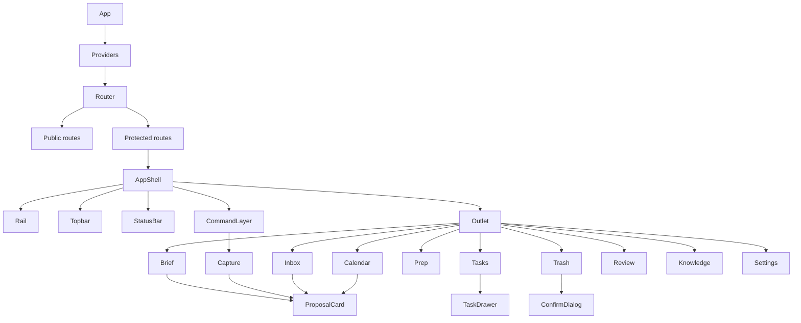

### 9.3 State ownership

| State | Owner | Tool |
|---|---|---|
| Session / token | Auth provider | Firebase SDK + context |
| Server data | Query cache | TanStack Query |
| Brief today | Query key `['brief','today']` | TanStack Query |
| Tasks by status | Query key `['tasks', status]` | TanStack Query |
| Filters / tabs | URL search params | React Router |
| Command palette open | UI store | Zustand or context |
| Drawer / dialog | Local route or UI store | Local state |
| Toasts | UI store | Sonner or custom |
| Optimistic mutations | Mutation hooks | TanStack Query |

- Do not duplicate server data in a global store.
- Invalidate `['tasks']` after capture accept, brief accept, email task creation,
  and LeetCode review task creation.
- Invalidate `['brief','today']` after accepting a brief item and after midnight.

### 9.4 API client

```ts
type ApiError = {
  status: number;
  code?: string;
  message: string;
  retryAfter?: number;
};

async function apiFetch<T>(
  path: string,
  init: RequestInit & { timeoutMs?: number } = {}
): Promise<T>;
```

- Base URL: `VITE_API_BASE_URL` (default `http://localhost:8000`).
- Inject `Authorization: Bearer <Firebase ID token>`.
- On 401: refresh once, retry once, then sign out.
- Timeouts: 15s normal, 30s triage/sync, 60s brief composition.
- Parse `Retry-After` on 429 and expose a countdown.
- Runtime-validate durable payloads (`Brief`, `Task`, `CaptureResponse`) with Zod;
  log a contract error rather than rendering `undefined`.
- Never trust the API to return sorted data; group and sort in selectors.

---

## 10. Stack and tooling

| Concern | Choice | Why |
|---|---|---|
| Build | Vite 6 + React 18 + TypeScript | Fast, matches the prior SPA |
| Routing | React Router 7 | Nested routes, URL state |
| Server state | TanStack Query v5 | Caching, retries, optimistic updates |
| UI state | Zustand | Small, no provider pyramid |
| Styling | Tailwind 3 + CSS variables | Tokens stay portable |
| Primitives | Radix UI (unstyled) | Accessible dialogs, menus, tabs |
| Drag | `@dnd-kit` | Accessible, keyboard-first |
| Charts | Recharts | Easy to restyle, no gradients |
| Dates | `date-fns` + `date-fns-tz` | Local timezone, week math |
| Validation | Zod | API boundaries and env |
| Toasts | Sonner or custom | Undo patterns |
| Icons | Lucide | 1.5px line, square geometry |
| Tests | Vitest + RTL + MSW + Playwright | Unit, contract, E2E |
| Lint | ESLint + Prettier | Consistency |

**Do not use** a component library that imposes rounded corners, shadows, or
its own type scale. Radix gives behaviour without visual opinion.

---

## 11. API contract map

### 11.1 Endpoints the UI will use

| Endpoint | UI use |
|---|---|
| `GET /healthz` | Status bar, degraded states |
| `POST /api/capture` | Capture proposals |
| `GET/POST /api/tasks` | Ledger, create |
| `PATCH/DELETE /api/tasks/:id` | Edit, complete, archive, restore, purge |
| `GET /api/briefing` | Dashboard |
| `POST /api/briefing/refresh` | Refresh |
| `POST /api/briefing/accept` | Accept a priority |
| `GET/POST /api/leetcode/patterns` | Pattern library |
| `POST /api/leetcode/patterns/:id/delete` | Delete pattern |
| `GET/POST /api/leetcode/attempts` | Attempt history / log |
| `GET /api/leetcode/stats` | Prep stats |
| `GET/POST /api/knowledge/*` | Principles, search, feedback, weights |
| `GET /api/integrations` | Connection states |
| `GET/POST /api/integrations/dailydev/feeds` | Tech radar |
| `GET /api/integrations/google/url` | Calendar consent |
| `GET /api/integrations/gmail/url` | Gmail consent |
| `DELETE /api/integrations/google` | Disconnect calendar |
| `DELETE /api/integrations/gmail` | Disconnect Gmail |
| `POST /api/integrations/gmail/triage` | Run triage |
| `GET /api/email/triage?state=` | Inbox list |
| `POST /api/email/triage/:msg_id/act` | Done / create task |
| `POST /api/calendar/sync` | Sync mirror |
| `GET /api/calendar/events?days=&fresh=` | Week view |
| `GET /api/calendar/plan` | Gaps and suggestions |
| `GET/PUT /api/profile` | Profile |
| `GET /api/onboarding` | Checklist |
| `POST /api/onboarding/seed` | Starter tasks |
| `GET /api/review/weekly?week=` | Review |
| `POST /api/review/weekly/run` | Run review |

### 11.2 Contract gaps and blockers

| # | Severity | Issue | Frontend consequence | Recommended fix |
|---|---|---|---|---|
| B1 | **P0** | `POST /api/capture` persists proposals when DB is configured | UI cannot offer “dismiss”; proposals already exist | Remove persistence; accept via `POST /api/tasks`, or add `persist:false` |
| B2 | **P0** | Calendar planner queries `priority = 'not_urgent_important'` | Suggestions always empty | Change to `'schedule'` |
| B3 | **P1** | Plan suggestions include a time; tasks store only `due_date` | Accepting loses the proposed time | Add `scheduled_start`/`scheduled_end` or return date-only suggestions |
| B4 | **P1** | `PATCH /api/tasks/:id` uses `COALESCE`; cannot null `due_date` | “Clear date” silently fails | Support explicit null / tri-state patch |
| B5 | **P1** | Capture source `nl_capture` is rejected by `POST /api/tasks` whitelist | Accepting a capture as `nl_capture` fails | Add `nl_capture` to allowed sources, or send `source: "user"` |
| B6 | **P1** | No brief history endpoint | No date navigation on Brief | Add `GET /api/briefing?date=` |
| B7 | **P2** | No task `archived_at` | Trash cannot show archived date | Add column or audit event |
| B8 | **P2** | No pagination/filter/sort on `GET /api/tasks` | Large ledgers load everything | Add `limit`, `cursor`, `priority`, `tag` |
| B9 | **P2** | No attempt edit route (README drift) | Cannot correct an attempt | Implement `PATCH` or remove the claim |
| B10 | **P2** | No bulk task endpoints | Bulk restore/purge requires loops | Add bulk actions or keep single-item UI |
| B11 | **P2** | No durable run log endpoint | Agent run strip is session-only | Add `GET /api/runs` or keep the strip explicit |
| B12 | **P3** | No Gmail body endpoint | Cannot preview a message in-app | Keep “Open in Gmail” external |
| B13 | **P3** | No OpenAPI/ts-rs contract | Hand-written DTOs drift | Generate types from Rust or add schema snapshots |
| B14 | **P3** | Review has no range/trend endpoint | Trend charts need N requests | Add `from`/`to` or a series endpoint |

**Doc drift to correct in the UI contract**

- LeetCode is `/api/leetcode/attempts`, not `/attempt`.
- Calendar plan is `GET`, not `POST`.
- Disconnect is `DELETE /api/integrations/google` and `/gmail`, not `/disconnect`.
- Email action is `{ action: "task" }`, not `"convert_to_task"`; the path uses the
  Gmail message id.
- `GET /api/tasks` filters only by `status`; no `since`/`limit`.

---

## 12. Accessibility

**Target: WCAG 2.2 AA.**

- Contrast: verify `--crimson` on `--canvas` for large text only; use
  `--crimson-deep` for small text. Verify `--muted` ≥ 4.5:1. Run axe in CI.
- Focus: visible 2px crimson ring, 2px offset, never removed.
- Keyboard: every action reachable; drawers/dialogs trap focus and restore it.
- Semantics: one `h1` per page; landmarks for rail, main, status; buttons are
  buttons, links are links.
- Live regions: announce brief composition, triage results, sync errors.
- Forms: labels, descriptions, errors tied with `aria-describedby`; no colour-only
  errors.
- Drag: always provide a non-drag alternative.
- Motion: honour `prefers-reduced-motion`.
- Touch: 44×44 minimum; no hover-only destructive action.
- Charts: provide a table alternative and text summary.
- Copy: no reading level above Grade 10 for critical actions.

---

## 13. Performance and reliability

| Budget | Target |
|---|---|
| LCP | < 2.5s on mid-range mobile |
| INP | < 200ms |
| CLS | < 0.1 |
| Initial JS | < 180KB gzipped |
| Route chunk | < 100KB gzipped |
| Fonts | 3 families, subset, swap |

**Techniques**

- Route-level code splitting; prefetch on rail hover/focus.
- TanStack Query caching with sensible `staleTime`: brief 5m, tasks 30s,
  integrations 5m, knowledge 10m.
- Optimistic complete/archive/restore; rollback with toast.
- Virtualise inbox and large ledgers once >100 rows.
- Skeletons match final module dimensions to avoid CLS.
- Abort in-flight requests on route change.
- Retry only idempotent GETs; never auto-retry mutations.
- Error boundaries per route; preserve last good data.
- Cache the last brief in memory for instant render; mark stale when offline.

### 13.1 Observability

- **Error reporting:** Sentry (or equivalent) on the client, with route, build
  SHA, and request ID; never attach tokens, email subjects, or brief text.
- **Web Vitals:** report LCP, INP, CLS per route; alert on regressions.
- **Product events:** `brief_viewed`, `brief_refreshed`, `proposal_accepted`,
  `proposal_edited`, `proposal_dismissed` (with reason), `task_created`,
  `task_completed`, `task_archived`, `task_restored`, `triage_acted`,
  `attempt_logged`, `integration_connected`, `integration_disconnected`.
- **LLM transparency:** log latency, status, and retry count per job; do not log
  prompts or completions in the browser.
- **Health:** poll `/healthz` on app boot and after failures; show capability in
  the status bar.

---

## 14. Testing plan

| Layer | Cover |
|---|---|
| Unit | Priority labels, date formatting, confidence rules, proposal reducer |
| Component | Button states, ProposalCard, TaskCard, EmptyState, ConfirmDialog |
| Contract | MSW fixtures for every endpoint; 401 refresh; 429 `Retry-After`; 503 |
| Integration | Capture → accept → ledger; brief accept; archive → restore → purge |
| E2E | Onboarding; daily loop; triage; prep attempt; review; disconnect Google |
| Accessibility | axe on every route; keyboard-only pass; focus restoration |
| Visual | Dashboard, task drawer, mobile nav, empty/loading/error fixtures |

**Fixture rule:** never ship a fixture that looks like real personal data. Use
obviously synthetic names and dates.

---

## 15. Build sequence

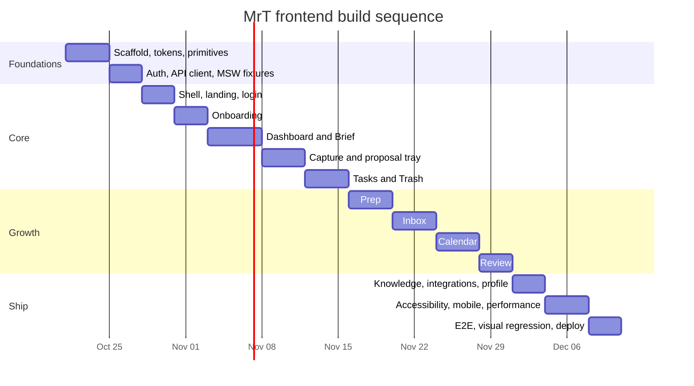

**Sequencing note:** fix blockers **B1**, **B2**, and **B5** before building
Capture or Calendar. They change the meaning of the UI, not just the data.

---

## 16. Definition of done

- [ ] Every route has loading, empty, error, degraded, and offline behaviour.
- [ ] Every AI output is a proposal with source, confidence, and reason.
- [ ] Accepting is explicit; nothing is selected or written automatically.
- [ ] Trash supports restore and permanent purge with confirmation.
- [ ] Buttons have default, hover, active, focus, disabled, and loading states.
- [ ] All interactive elements are keyboard reachable; focus is restored.
- [ ] axe passes on all routes; contrast is verified.
- [ ] Mobile tested at 320px and 430px; no horizontal scroll.
- [ ] No fake metrics; every number has an API or a documented formula.
- [ ] The brief is usable when the LLM is down (cached/manual mode).
- [ ] The API client handles 401, 429, 503, and timeouts specifically.
- [ ] Contract fixtures exist for every endpoint used.
- [ ] Bundle and Web Vitals budgets pass.
- [ ] No rounded corners, shadows, gradients, or glows.
- [ ] The status bar tells the truth about sync and capability.

---

## 17. Decisions still open

1. **Brand:** is the product called **MrT** everywhere, or is MrT the agent inside
   “Growth Copilot”? The frontend copy needs one answer.
2. **Canvas token:** confirm `#F2EDE4` as canvas (screenshot) or `#EAE5DC`
   (DESIGN prose). Pick one and delete the other.
3. **Dashboard metric:** define “week completion” or remove it. Do not ship
   “velocity” without a formula.
4. **Navigation:** icon rail + More, or a labelled sidebar? The rail preserves the
   editorial feel; a sidebar is faster to scan.
5. **Landing page:** is `/` a public marketing page or an auth redirect?
6. **Trash retention:** unlimited until purge, or a retention window? The backend
   currently keeps archived tasks indefinitely.
7. **Dark mode:** not in scope until the light palette is proven; the ink modules
   are not a theme.
8. **Icon set:** Lucide line icons fit the geometry; confirm no Material Symbols
   carry-over.
9. **Run log durability:** client-only in v1, or add a backend runs endpoint.
10. **Capture acceptance source:** `nl_capture` in `POST /api/tasks`, or always
    `user`? This changes provenance badges.

---

## 18. What “done” looks like

A user opens MrT at 07:10. The brief is already composed. They see one headline,
three priorities with reasons, a two-hour gap in their calendar, one LeetCode
pattern due, and three inbox decisions. They accept two priorities, dismiss one
with a reason, drag a task from `schedule` to `now`, log a drill attempt, archive
a stale task, then close the tab. Tomorrow, the brief reflects what they did.

No chat window. No fake numbers. No mystery writes. Just a calm, editorial surface
over a system that proposes and remembers.
